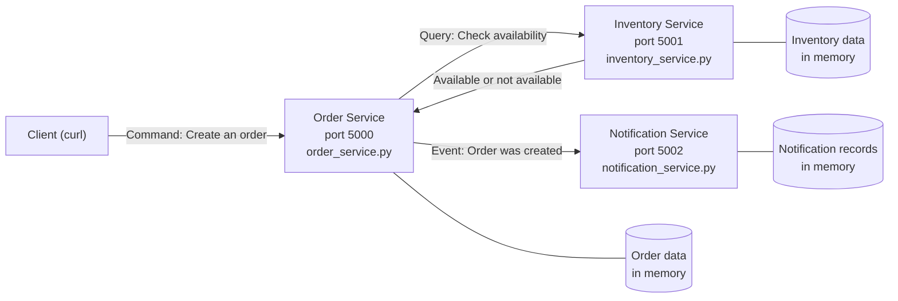

# CMPE 273 - Lab 4: Distributed Online Store

In this lab I built a small online store with Python. The system is split
into three services. Each service runs as its own process. Each service
owns its own data and talks to the other services only through HTTP APIs.

I used Flask for the services and the `requests` library for calls between
services. All data is kept in memory. A database is not used in this lab.

## Architecture



The client only talks to the Order Service. The Order Service checks stock
with the Inventory Service before it creates an order. After an order is
created, the Order Service sends an event to the Notification Service.

## Responsibility of Each Service

### Order Service (`order_service.py`, port 5000)

- It receives create order requests from the client.
- It validates the request. It checks the customer, the item id, and the quantity.
- It asks the Inventory Service if the item is available.
- It creates the order only if the item is available.
- It stores the order and sets the order status.
- It sends an order created event to the Notification Service.
- It handles the case where the Inventory Service is down. It returns an
  error and it keeps running.

### Inventory Service (`inventory_service.py`, port 5001)

- It stores the item catalog.
- It stores the stock count for each item.
- It answers availability questions from the Order Service.
- It returns `available: true` if the stock is enough for the request.
- It returns `available: false` if the stock is not enough.
- It returns a 404 error if the item does not exist.

### Notification Service (`notification_service.py`, port 5002)

- It receives the order created event from the Order Service.
- It builds a short notification message for the customer.
- It stores a record of each notification it sends.
- It does not create orders and it does not check stock.

## Data Ownership

| Service | Data it owns | Data it does not own |
| --- | --- | --- |
| Order Service | Order id, customer, item id and quantity for the order, order status | Stock count, item catalog |
| Inventory Service | Item id, item name, stock count | Orders, notifications |
| Notification Service | Notification message, notification record for an order | Orders, stock count |

Each service keeps its data in its own memory. No service reads the data of
another service directly. A service must call the API of the owner service
if it needs that data. For example, the Order Service never reads the
inventory data directly. It always asks the Inventory Service.

Sample inventory data used in this lab:

| Item id | Name | Stock |
| --- | --- | --- |
| laptop | Laptop | 10 |
| phone | Phone | 5 |
| keyboard | Keyboard | 25 |
| headphones | Headphones | 0 |

## Why I Chose These Service Boundaries

I split the system by responsibility. Orders, stock, and notifications are
three different jobs, so I placed them in three different services.

This split has a few clear benefits:

- Stock rules live in one place. If the stock logic changes, I only change
  the Inventory Service.
- Order rules live in one place. Order validation and order status are handled
  only by the Order Service.
- Notification code is separate. A change in the message format does not
  affect order creation or stock checks.
- Each service can fail on its own. The Order Service can detect a failed
  Inventory Service and return a clean error.
- Each service can be tested on its own. I can test the availability API
  without creating an order.

## Command, Query, and Event

| Interaction | Type | Reason |
| --- | --- | --- |
| Check whether an item is available | Query | It only reads the current stock. It does not change any data. The caller expects an answer about the present state. |
| Create an order | Command | It is a request to do an action. It asks the system to change state and create a new order. The caller expects the action to succeed or fail. |
| Order was created | Event | It states a fact that already happened. It is sent after the order is saved. The Notification Service reacts to this fact. It does not ask the Notification Service to create the order. |

In short, a command asks for a change, a query asks for data, and an event
reports that something has already happened.

## How the Main Interaction Works

1. The client sends a create order request to the Order Service.
2. The Order Service validates the request.
3. The Order Service sends an availability query to the Inventory Service.
4. The Inventory Service checks its stock and sends the result back.
5. If the item is available, the Order Service saves the order with status
   `CONFIRMED` and returns HTTP 201.
6. If the item is not available, the Order Service returns HTTP 409 and it
   does not create an order.
7. If the item does not exist, the Order Service returns HTTP 404.
8. After a successful order, the Order Service sends an order created event
   to the Notification Service.

## API Summary

Inventory Service:

- `GET /health`
- `GET /inventory`
- `GET /inventory/<item_id>`
- `GET /inventory/<item_id>/availability?quantity=1`

Order Service:

- `GET /health`
- `POST /orders`
- `GET /orders`
- `GET /orders/<order_id>`

Notification Service:

- `GET /health`
- `POST /notify`
- `GET /notifications`

## How to Install and Run

You need Python 3 on your machine.

Clone the repository and go to the project folder:

```bash
git clone https://github.com/vsh2504/cmpe273-lab4.git
cd cmpe273-lab4
```

Create a virtual environment and install the dependencies:

```bash
python3 -m venv .venv
source .venv/bin/activate
pip install -r requirements.txt
```

Run each service in a separate terminal. Keep all three terminals open.

Terminal 1, Inventory Service:

```bash
python inventory_service.py
```

Terminal 2, Notification Service:

```bash
python notification_service.py
```

Terminal 3, Order Service:

```bash
python order_service.py
```

The services run on these ports:

- Order Service: http://127.0.0.1:5000
- Inventory Service: http://127.0.0.1:5001
- Notification Service: http://127.0.0.1:5002

## Example of a Successful Request

First I checked the availability of a laptop. This is the query:

```bash
$ curl -s "http://127.0.0.1:5001/inventory/laptop/availability?quantity=1"
{"available":true,"item_id":"laptop","requested":1,"stock":10}
```

Then I created an order for the laptop. This request returned HTTP 201:

```bash
$ curl -s -w "\nHTTP %{http_code}\n" -X POST http://127.0.0.1:5000/orders \
  -H "Content-Type: application/json" \
  -d '{"customer":"Vinayak","item_id":"laptop","quantity":1}'
{"customer":"Vinayak","item_id":"laptop","order_id":"ORD-1","quantity":1,"status":"CONFIRMED"}
HTTP 201
```

After this order, the Notification Service had one record. This shows that
the order created event reached the Notification Service:

```bash
$ curl -s http://127.0.0.1:5002/notifications
[{"customer":"Vinayak","message":"Order ORD-1 was created for Vinayak. Item: laptop.","order_id":"ORD-1"}]
```

I also tested an item with no stock. Headphones have a stock of 0, so this
order failed with HTTP 409 and no order was created:

```bash
$ curl -s -w "\nHTTP %{http_code}\n" -X POST http://127.0.0.1:5000/orders \
  -H "Content-Type: application/json" \
  -d '{"customer":"Vinayak","item_id":"headphones","quantity":1}'
{"error":"item is not available in the requested quantity","item_id":"headphones","requested":1,"stock":0}
HTTP 409
```

## Failure Test

Test steps:

1. I started all three services.
2. I created one order and it succeeded.
3. I stopped the Inventory Service.
4. I submitted the same order again.
5. I checked the health of the Order Service.

Result with the Inventory Service stopped:

```bash
$ curl -s -w "\nHTTP %{http_code}\n" -X POST http://127.0.0.1:5000/orders \
  -H "Content-Type: application/json" \
  -d '{"customer":"Vinayak","item_id":"laptop","quantity":1}'
{"error":"Inventory Service is unavailable. The order was not created. Please try again later."}
HTTP 503
```

The Order Service did not crash. Its health check still returned HTTP 200:

```bash
$ curl -s -w "\nHTTP %{http_code}\n" http://127.0.0.1:5000/health
{"service":"order","status":"ok"}
HTTP 200
```

The Order Service handles this case in code. It calls the Inventory Service
with a timeout of 2 seconds. If the call fails, it catches the request
exception, returns HTTP 503, and does not create the order.

I also restarted the Inventory Service and submitted a new order. The new
order succeeded, so the system recovered after the failure:

```bash
$ curl -s -w "\nHTTP %{http_code}\n" -X POST http://127.0.0.1:5000/orders \
  -H "Content-Type: application/json" \
  -d '{"customer":"Vinayak","item_id":"phone","quantity":1}'
{"customer":"Vinayak","item_id":"phone","order_id":"ORD-2","quantity":1,"status":"CONFIRMED"}
HTTP 201
```

## Project Structure

```text
cmpe273-lab4/
|-- README.md
|-- requirements.txt
|-- .gitignore
|-- order_service.py
|-- inventory_service.py
`-- notification_service.py
```

## Reflection

Clear service boundaries are important because each service can change its
own code without breaking the others, as long as its API stays the same.
Data ownership avoids confusion because only one service is responsible for
a given record, such as stock in the Inventory Service and orders in the
Order Service. This also helps with failures, because one service can fail
and the others can detect the error and stay in a safe state. As the system
grows, these rules make it easier to scale, test, and add new services
without tight coupling.
